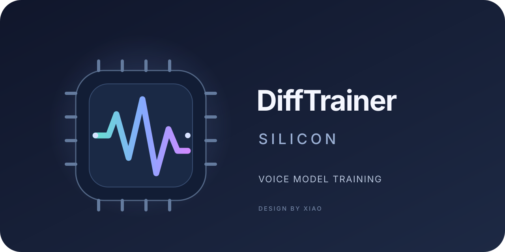

# DiffTrainer Silicon

An Apple Silicon focused variant of DiffTrainer. The desktop app provides DiffSinger data preparation, configuration, binarization, training, quick inference, and singer export for OpenUtau. macOS and MPS support are experimental.

## Project status

- **macOS on Apple Silicon:** technical workflows have been exercised with synthetic data and checkpoints: GUI startup, data preparation and binarization, ten MPS acoustic training updates, acoustic inference, and SOME inference. These checks confirm that the workflows run; they do not establish vocal quality, long-run training stability, or compatibility with a real corpus.
- **Windows:** launchers and Conda recipes are organized under `platform/windows/`. The primary Windows version remains in the [official DiffTrainer repository](https://github.com/agentasteriski/DiffTrainer).
- **Linux:** Conda recipes are available under `platform/linux/`, but this variant has not been validated on Linux.
- **Core ML and Neural Engine:** a standalone proof of concept can convert and compare the acoustic backbone. It is not integrated into the app and still needs a compatible acoustic checkpoint for a real comparison.
- **Opencpop:** a data preparation tool and experimental training configuration are included. Training has not been validated with the corpus and a compatible checkpoint.

Development examples, checkpoints, and test data are not included in the repository. The local `docs/` folder is also ignored by Git.

## Installation by platform

### Windows

Install Miniconda or Anaconda, clone or extract this repository, and run `platform/windows/reconfigure_conda_env.bat` to recreate the Conda environment named `difftrainer`. The script first removes an existing `difftrainer` environment. Then launch the app with `run_gui.bat`; use `run_quickinference.bat` and `launch_tensorboard.bat` for the corresponding tools. The `.bat` files in the repository root are compatibility launchers.

### Linux

Conda recipes are in `platform/linux/environment.yml` and `platform/linux/base_environment.yml`. Create and activate an environment using the recipe you choose, then run `python difftrainer.py` or use `./run_gui.sh` from the active environment. This variant has not yet been validated on Linux.

### macOS on Apple Silicon

#### Requirements

- An Apple Silicon Mac running a recent macOS version.
- ARM64 Python 3.10 and Tk 8.6. The local development environment was also checked with Python 3.14, but its dependency list is experimental.
- Disk space for the Python environment, DiffSinger, helper models, corpus, and checkpoints.

#### Installation

Install Python and Tk with Homebrew, create a virtual environment in the repository root, and install the dependencies:

```bash
brew install python@3.10 python-tk@3.10
/opt/homebrew/bin/python3.10 -m venv .venv
source .venv/bin/activate
python -m pip install --upgrade pip
python auto_torch.py
python -m pip install -r requirements.txt
```

`auto_torch.py` selects a PyTorch installation for the machine. Review its output and confirm that PyTorch detects MPS before starting a training run. `requirements.txt` is the general app dependency list; the package combination remains experimental on macOS.

Start the app from the repository root:

```bash
./run_gui.sh
```

The launcher sets `PYTORCH_ENABLE_MPS_FALLBACK=1`, changes to the repository root, and runs `difftrainer.py`. The **Binarize & Train** tab shows the detected device. The fallback lets operations without Metal support run on the CPU and may reduce performance.

The **Update tools** button downloads DiffSinger, SOME, and helper models. The update can replace files inside `DiffSinger/`; back up any personal files in that folder before using it. The button was not rerun during this validation because the local folder contains models and checkpoints that would be replaced.

#### Low-memory configuration

`platform/macos/config_mac_lowmem.yaml` is an acoustic smoke-test configuration for an Apple Silicon Mac with 8 GB of memory. It selects MPS, `32-true` precision, zero DataLoader workers, and ten updates. Copy it to `DiffSinger/configs/`, update `datasets` and `binary_data_dir` for your project, and select it in the app.

This file is intentionally limited to ten updates. Create a separate configuration for real training and tune batch size, maximum sequence length, validation, and update count for your corpus and available memory.

## App workflow

1. **Prepare data:** organize audio and labels in the format expected by DiffSinger. Use the data preparation tab to segment audio, convert labels, estimate notes, or create `.ds` files as needed.
2. **Configure:** choose a model type and set the corpus, dictionaries, binary data, and checkpoint paths. The configuration must match the DiffSinger version and data in use.
3. **Binarize and train:** run binarization, then training. On macOS, start with a small dataset and zero workers while checking memory use and compatibility.
4. **Infer:** open Quick Inference from the app or run `./run_quickinference.sh`. Inference uses PyTorch; Core ML is not an app backend.
5. **Export:** use the **Export Singer** tab to generate OpenUtau artifacts. Check the result in OpenUtau with a real checkpoint and data before distributing a voice.
6. **Inspect training:** run `./launch_tensorboard.sh` to open TensorBoard for `DiffSinger/checkpoints/`.

MPS acoustic training and inference were run with synthetic tones and a checkpoint trained for ten updates. GUI validation reached event loop startup, but the interface was not visually reviewed or fully exercised. An ONNX export was also generated from the synthetic checkpoint, but it was not loaded in OpenUtau.

## Opencpop data preparation

The corpus is not included. Obtain it through authorized means and check the provider's current terms. The preparation tool expects a `segments/` folder containing `transcriptions.txt` and a `wavs/` folder containing the referenced audio files.

```bash
python tools/opencpop/prepare_opencpop.py \
  --source /path/to/Opencpop/segments \
  --output DiffSinger/data/opencpop/raw
```

The command writes `transcriptions.csv` and creates a link to the `wavs/` folder inside the output directory. Pass `--overwrite` to replace an existing CSV. The corresponding experimental training configuration is `tools/opencpop/opencpop_acoustic.yaml`; review the corpus, dictionary, and output paths before using it. Preparing the CSV does not validate the training recipe.

## Package data for another environment

`tools/data/pack_for_cloud.sh` creates a tar.gz archive containing a `binary/` folder and a copy of the configuration with `binary_data_dir: binary`:

```bash
tools/data/pack_for_cloud.sh \
  DiffSinger/data/opencpop/binary \
  tools/opencpop/opencpop_acoustic.yaml \
  /path/to/opencpop-binary.tar.gz
```

Replace these paths with the locations in your project. The script only creates a local archive; it does not upload data to a service. Check the archive size, contents, permissions, and your authorization to transfer the corpus before sharing it.

## Core ML experiment

`tools/coreml/coreml_acoustic_poc.py` captures a real acoustic backbone call, converts it to an ML Program, and compares its outputs and audio with PyTorch. The report includes conversion and load times, warmed inference medians, output error, and the local compute plan when available.

To reproduce the Core ML Tools environment used during development on an Apple Silicon Mac with Python 3.14:

```bash
python -m pip install -r platform/macos/requirements-macos-arm64-py314.in
git clone https://github.com/apple/coremltools.git /tmp/coremltools
git -C /tmp/coremltools checkout a207b1a3452eafe02f2d870f486287834af2c82d
python -m pip install -e /tmp/coremltools
```

The local development environment reported Core ML Tools `9.1.dev1` from the commit above, PyTorch 2.14.1, and MPS available. That combination was used to inspect the API and build the tool, but PyTorch was newer than the latest version tested by Core ML Tools at the time (2.8.0).

With DiffSinger installed, a compatible acoustic checkpoint, and a matching `.ds` file, run:

```bash
python tools/coreml/coreml_acoustic_poc.py \
  --diffsinger DiffSinger \
  --experiment experiment_name \
  --ds /path/to/input.ds \
  --output /path/to/acoustic-backbone.mlpackage \
  --language en \
  --speaker singer
```

The experiment must be located at `DiffSinger/checkpoints/experiment_name`. Set the language and speaker to match the checkpoint and `.ds` file; omit `--language` and `--speaker` when those values are already present. Use `--checkpoint-step`, `--warmup`, and `--runs` to select a checkpoint and adjust measurements.

This checkout does not yet have a compatible checkpoint for a real comparison. Requesting `ComputeUnit.ALL`, completing conversion, or obtaining a low numerical error does not prove that operations ran on the Neural Engine. App integration depends on comparison with real data, inspection of the execution plan, and useful performance.

## Repository structure

| Path | Contents |
| --- | --- |
| `difftrainer.py` | Compatibility entry point for the main app. |
| `quickinference.py` | Compatibility entry point for Quick Inference. |
| `auto_torch.py` | Compatibility entry point for PyTorch setup. |
| `check_update.py` | Compatibility entry point for the app updater. |
| `src/difftrainer_app/gui/` | Main desktop interface. |
| `src/difftrainer_app/inference/` | Quick Inference interface. |
| `src/difftrainer_app/updater/` | App updater and PyTorch setup helper. |
| `src/difftrainer_app/modules/` | Data preparation, helper inference, and export modules. |
| `src/difftrainer_app/resources/` | App icons, themes, fonts, sounds, and translations. |
| `config/` | User settings, created on first launch and ignored by Git. |
| `requirements.txt` | General Python dependency list. |
| `platform/windows/` | Windows launchers and Conda recipes. |
| `platform/linux/` | Linux Conda recipes; not yet validated for this variant. |
| `platform/macos/` | Low-memory config and experimental Core ML dependencies. |
| `tools/macos/` | macOS maintenance tools that apply MPS patches to DiffSinger and SOME. |
| `tools/opencpop/` | Opencpop data preparation and experimental training config. |
| `tools/coreml/` | Standalone Core ML conversion and comparison proof of concept. |
| `tools/data/pack_for_cloud.sh` | Packages binary data and config for manual transfer. |
| `documentation/` | Project announcement, changelog, and additional credits. |
| `platform/macos/patches/` | Maintained MPS patches applied by the macOS maintenance tools. |
| `platform/macos/launchers/` | macOS shell launcher implementations. |
| `run_gui.bat`, `run_quickinference.bat`, `reconfigure_conda_env.bat`, `launch_tensorboard.bat` | Root compatibility launchers for older Windows shortcuts. |
| `run_gui.sh`, `run_quickinference.sh`, `launch_tensorboard.sh` | Root compatibility launchers forwarding to `platform/macos/launchers/`. |

## Credits and acknowledgements

This project continues the [original DiffTrainer](https://github.com/agentasteriski/DiffTrainer), whose About tab credits Xiao as maintainer. Its upstream [additional credits](https://github.com/agentasteriski/DiffTrainer/blob/main/extracredits.md) identify these included contributions and assets:

- **MLo7Ghinsan:** the [`corpus_segmenter`](https://github.com/MLo7Ghinsan/ghin_shenanigans/blob/main/scripts/corpus_segmenter.py) and legacy code from the predecessor project.
- **UtaUtaUtau:** logic from [`nnsvs-db-converter`](https://github.com/UtaUtaUtau/nnsvs-db-converter), used by [liteconvert](https://github.com/agentasteriski/liteconvert).
- **OpenVPI:** logic from [`variance-temp-solution`](https://github.com/openvpi/MakeDiffSinger/tree/main/variance-temp-solution), used by `csv2ds` and `get_pitch`; the [DiffSinger](https://github.com/openvpi/DiffSinger) and [SOME](https://github.com/openvpi/SOME) projects are also used.
- **Fonts:** [Red Hat Display](https://fonts.google.com/specimen/Red+Hat+Display), [M PLUS 2](https://fonts.google.com/specimen/M+PLUS+2), [Noto Sans SC](https://fonts.google.com/noto/specimen/Noto+Sans+SC), and [Noto Sans TC](https://fonts.google.com/noto/specimen/Noto+Sans+TC).
- **Icon:** a colorized `hard-drive.svg` from [Zondicons](https://www.zondicons.com/).

The original credits also list these external model downloads: [pc-nsf-hifigan 44.1 kHz](https://github.com/openvpi/vocoders/releases/tag/pc-nsf-hifigan-44.1k-hop512-128bin-2025.02), [RMVPE](https://github.com/yxlllc/RMVPE/releases/tag/230917), and [hnsep_240512](https://github.com/yxlllc/vocal-remover/releases/tag/hnsep_240512). The upstream notes that many downloads are served from forks.

Please review the license and usage terms for each project, font, model, and corpus. The [additional credits file](documentation/extracredits.md) is retained in this repository.
